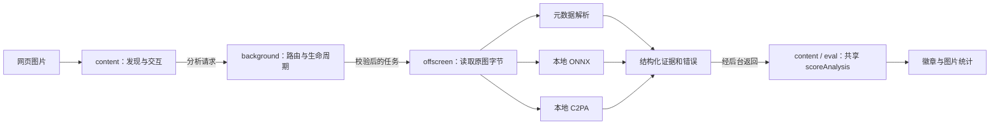

# 本地检测扩展的边界

offscreen 从图片原站读取一次文件，三个检测通路共享字节。不把图片发给检测平台；官方核验入口由用户手动使用。

| 层 | 允许做的事 | 共用规则 |
|---|---|---|
| content | 发现图片、请求分析、处理过期异步结果、缓存与展示 | contracts、scoring |
| background | 验证消息角色和载荷、维持 offscreen 生命周期、读取设置 | contracts |
| offscreen | 限制并发、下载、元数据/模型/验签、阶段错误 | contracts、metadata、provenance |
| popup / options | 展示统计、规范化设置、打开手动核验入口 | contracts |
| eval | 导入生产纯函数或真实浏览器生产通路 | 禁止另写一套评分/验签规则 |

## 共享契约

`src/shared/contracts.js` 是无环境副作用的经典脚本 / CommonJS 双入口。没有引入框架、编译依赖、后台服务或新权限。加载顺序由 manifest、HTML 以及 SW 的 importScripts 明确声明，构建检查这些引用。

设置只接纳已知字段和正确类型。`false` 不按真假值转换；损坏字段恢复各自默认值，signals 缺项补齐。storage 事件按整字段替换语义应用，删除也恢复默认。未知键不使检测缓存失效。旧 sensitivity 只读兼容，不改变颜色边界。

消息类型保留原字符串以兼容现有调用。分析 URL 接受 HTTP(S)、有限长度的内联位图、HTTP(S) blob 及 file 地址；file 仍受 Chrome 文件访问权限限制，blob 也可能因上下文不可读取。拒绝凭据 URL、非图片 data 和扩展内部 URL 等。原图响应仍由现有字节上限与超时约束；这不是网络代理或服务端 SSRF 防护。

| 接收方 | 发送角色 | 操作 |
|---|---|---|
| background | content | GET_SETTINGS、ANALYZE_IMAGE |
| background | popup / options | GET_SETTINGS |
| background | offscreen | __OFFSCREEN_READY__ |
| offscreen | background | __OFFSCREEN_PING__、IMAGE_ANALYZE |
| content | popup / options、background | GET_SUMMARY |

角色由 Chrome 提供的 sender.id、准确扩展 URL 与 tab 上下文判断，不信任消息里的“角色”字段。拒绝任务不会创建 offscreen 或读取图片。该设计防止无意的跨层调用和伪造控制消息；已篡改整个扩展的本地攻击者仍能更改代码，不把它当作 DRM。

## 证据与交付

`scoring.js` 仍是唯一决策入口；trusted C2PA AI 声明、未验签声明、模型估计和未完成状态分层。低于 40 红，40–60 黄，高于 60 绿；没有有效结果时灰色空分数。

构建从空暂存目录产生 ZIP，包含全部运行入口、模型、验签组件及许可/来源记录。源码审查与模型评测资料保留在仓库，测试图片不进入 ZIP。`NOTICE` 是第三方材料入口，`LICENSING.md` 记录权利边界及未决事项。
